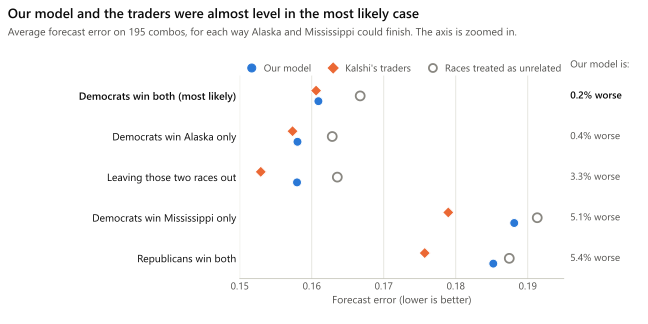
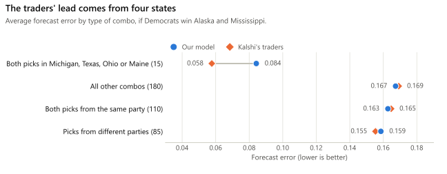
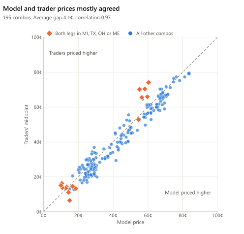
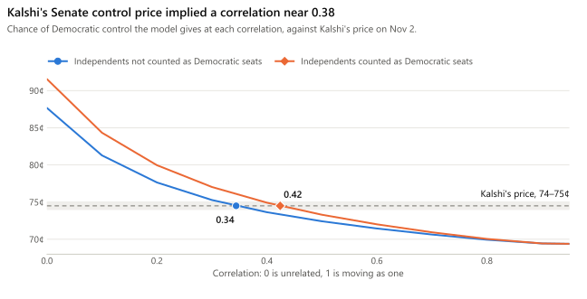
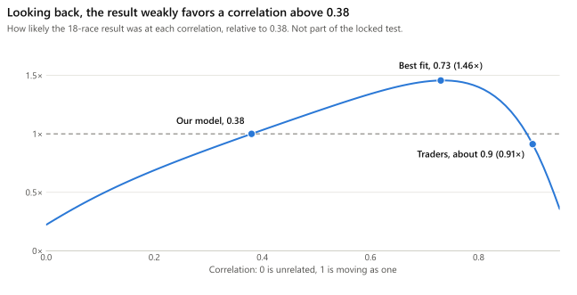

# Can a simple model price election bets as well as professional traders?

I tested this on the 2026 US Senate elections, using real prices from Kalshi, a US exchange where people trade on real-world events.

**The short answer is almost.** Across 195 bets, the model's forecasts were about as accurate as the traders' (0.2% worse). They were also 3.5% better than a simple approach that treats each race as unrelated to the others. Being accurate doesn't mean the model could make money, and [one election can't prove much](#what-this-doesnt-prove).

> **These results aren't final.** 16 of the 18 races in the test have officially settled. Alaska and Mississippi haven't, so the main numbers here assume Democrats win both. On Nov 4, Kalshi's prices gave Democrats a 92% chance in Alaska and 93% in Mississippi.

## The idea

A Kalshi contract pays &#36;1 if something happens. If it costs 70¢, the market sees about a 70% chance.

A **combo** is a bet on several things at once, and it pays only if all of them happen. Take "Democrats win both Michigan and Texas". You might expect to price it by multiplying the two chances, but that only works if the races have nothing to do with each other. In reality, a good night for a party nationally tends to help it everywhere.

So the price depends on how much races move together:

| "Democrats win both Michigan and Texas" | Price on Nov 2 |
| --- | --- |
| Michigan alone | 77.5¢ |
| Texas alone | 72.5¢ |
| Combo, if the two races were unrelated | 56¢ |
| Combo, according to my model | 60¢ |
| Combo, according to Kalshi's traders | 74¢ |

My model takes each race's price and adds one number for how much races move together. That number is called **correlation**: 0 means races are unrelated, and 1 means they always move as one. The model used 0.38, which I worked out from Kalshi's price on which party would control the Senate.

## What I did

1. **Built the model** to price any combo from its race prices and that one correlation number.
2. **Asked the traders for prices.** On Nov 2, the day before the election, I requested prices on all 754 possible pairs of picks across 18 Senate races. 652 got a reply, and 195 got both a price to buy and a price to sell. Those 195 are the ones I could compare fairly. I never bought or sold anything.
3. **Locked everything in** before polls opened on election day. The prices and the accuracy calculation were saved in a time-stamped record, so they couldn't be changed after the results came in.
4. **Scored the forecasts** once the results came in. For each combo, forecast error is the gap between the forecast and what happened, squared, then averaged across combos. A perfect forecaster scores 0, and always saying 50% scores 0.25. For the traders, I used the price halfway between their buy and sell prices.

## What I found

**The model and the traders nearly tied.** If Democrats win both remaining races, as expected, the model scores 0.1609 and the traders 0.1606. If Republicans win Alaska, the traders' lead grows to about 5%. The traders come out ahead in every case, and treating races as unrelated comes last in every case.

<picture>
  <source media="(prefers-color-scheme: dark)" srcset="docs/figures/accuracy-dark.svg">
  
</picture>

**The traders' lead comes from four states.** They treated Michigan, Texas, Ohio and Maine as moving almost together. Democrats won all four, so the traders were right about those. On the other 180 combos, the model was slightly ahead.

<picture>
  <source media="(prefers-color-scheme: dark)" srcset="docs/figures/breakdown-dark.svg">
  
</picture>

**The two usually gave similar prices.** On average they differed by 4.1¢, and the model's forecast was closer to the actual result on 99 combos against the traders' 96.

<picture>
  <source media="(prefers-color-scheme: dark)" srcset="docs/figures/prices-dark.svg">
  
</picture>

## What this doesn't prove

- **This is one election.** All these combos share the same 18 races and the same national mood, so they aren't 195 separate tests. Either side could have been lucky.
- **Accurate doesn't mean profitable.** The traders' buy and sell prices were typically 34¢ apart, while the model and the traders differed by about 4¢. Anyone trading would pay far more in that gap than the model's price difference could earn back.
- **The model isn't fully independent.** Its race prices and its correlation number both came from Kalshi.

---

*You can stop here. The rest is for readers who want the math or the code.*

## Technical details

**Model.** A one-factor Gaussian copula, using each race's price $p_i$ and a common correlation $\rho$, where $M$ is the shared national factor:

```math
Z_i = \sqrt{\rho}\,M + \sqrt{1-\rho}\,\varepsilon_i, \qquad M,\ \varepsilon_i \sim \mathcal{N}(0,1)
```

A leg wins when $Z_i < \Phi^{-1}(p_i)$, so given $M$ the legs are independent:

```math
P(\text{leg } i \text{ wins} \mid M) = \Phi\!\left(\frac{\Phi^{-1}(p_i) - \sqrt{\rho}\,M}{\sqrt{1-\rho}}\right)
```

```math
P(\text{all legs win}) = \int_{-\infty}^{\infty} \prod_i P(\text{leg } i \text{ wins} \mid M=m)\,\phi(m)\,dm
```

Republican legs load on $M$ with the opposite sign, so a Democratic win in one state and a Republican win in another are negatively related.

**Estimating correlation.** Senate control depends on the individual races, so `senate_rho.py` works out the distribution of Democratic seats $S$ among the 35 races up in 2026. Democrats hold 34 seats that aren't up and need 51 for control, so they need 17 of the 35. The estimate $\hat{\rho}$ is the value that matches Kalshi's control price:

```math
P(\text{control} \mid \rho) = \int_{-\infty}^{\infty} P(S \ge 17 \mid M=m)\,\phi(m)\,dm, \qquad P(\text{control} \mid \hat{\rho}) = \text{Kalshi's price}
```

That gave 0.34 if independents don't count as Democratic seats and 0.42 if they do. The test used 0.38.

<picture>
  <source media="(prefers-color-scheme: dark)" srcset="docs/figures/control-dark.svg">
  
</picture>

**Scoring.** Each forecast $f_j$ is compared with the outcome $y_j \in \{0, 1\}$. "Forecast error" above is the Brier score:

```math
\text{Brier} = \frac{1}{N}\sum_{j=1}^{N} (f_j - y_j)^2, \qquad \text{Log loss} = -\frac{1}{N}\sum_{j=1}^{N} \left[ y_j \ln f_j + (1-y_j)\ln(1-f_j) \right]
```

The traders' forecast is their bid-ask midpoint, $f_j = (b_j + a_j)/2$. The baseline sets $\rho = 0$, so $f_j$ is the product of the leg prices.

| Alaska and Mississippi | Combos | Model Brier | Traders Brier | Baseline Brier | Model log loss | Traders log loss | Baseline log loss | Model vs traders (Brier) |
| --- | --- | --- | --- | --- | --- | --- | --- | --- |
| **Democrats win both (most likely)** | 195 | **0.1609** | **0.1606** | 0.1667 | 0.5008 | 0.4994 | 0.5122 | **0.2% worse** |
| Democrats win Alaska only | 195 | 0.1580 | 0.1573 | 0.1628 | 0.4950 | 0.4933 | 0.5044 | 0.4% worse |
| Leaving those two races out | 156 | 0.1580 | 0.1529 | 0.1636 | 0.4943 | 0.4831 | 0.5055 | 3.3% worse |
| Democrats win Mississippi only | 195 | 0.1881 | 0.1790 | 0.1913 | 0.5593 | 0.5402 | 0.5650 | 5.1% worse |
| Republicans win both | 195 | 0.1852 | 0.1757 | 0.1874 | 0.5536 | 0.5340 | 0.5572 | 5.4% worse |

**How much correlation among swing states?** The traders' quotes implied $\rho \approx 0.9$ among Michigan, Texas, Ohio and Maine. Senate control can't rule that out, because a value that high for those four still fits the control price. Across all nine competitive states, it does rule out anything above about 0.65 (independents not counted).

**Looking back.** This wasn't part of the locked test, and it is weak evidence. It compares how likely the actual result was at each $\rho$:

```math
R(\rho) = \frac{P(\text{actual 18-race result} \mid \rho)}{P(\text{actual 18-race result} \mid \rho = 0.38)}
```

<picture>
  <source media="(prefers-color-scheme: dark)" srcset="docs/figures/fit-dark.svg">
  
</picture>

**Numerical integration.** Gauss-Hermite (64 nodes) for $\rho \le 0.8$. Above that, the conditional leg probabilities become near-steps in $M$ and Hermite nodes miss them (error reaches 0.04 at $\rho = 0.999$), so it switches to piecewise Gauss-Legendre with breakpoints at each step. Both agree with the exact bivariate normal to within $10^{-7}$ across $\rho \in [0, 0.999]$. One common factor can't make same-side legs negatively correlated, so $\rho \ge 0$.

## Running the code

The prices and accuracy calculation are locked at the git tag `preregistered-2026-11-02`, created before polls opened.

```
py -3.12 -m venv %USERPROFILE%\.venvs\kalshi-combo
%USERPROFILE%\.venvs\kalshi-combo\Scripts\pip install -r requirements.txt

python -m pytest -q
python score.py --results data/rfq/assumed_ak_ms.csv   # main result, assuming Democrats win AK and MS
python report_figures.py                               # redraw the charts
python senate_rho.py                                   # correlation from Senate control (uses live prices)
python rfq_scan.py --legs 2 --rho 0.38                 # dry run; --send needs an API key
```

The venv sits at a short path because deep project paths can exceed Windows' 260-character limit during `pip install`.

Once Alaska and Mississippi settle, plain `python score.py` gives the final result. Until then its output is skewed, because a combo with an undecided leg is only scored if its other leg has already lost.

Everything is read-only market data except `rfq_scan.py --send`, which creates combo markets and opens requests for quotes, signed with your API key from environment variables. It never accepts a quote, and it deletes every request it opens. Nothing here places orders.

| File | What it does |
| --- | --- |
| `pricing.py` | Prices a combo: `combo_prob(leg_probs, sides, rho)` |
| `senate_rho.py` | Correlation implied by Senate control, including the swing-state check |
| `rfq_scan.py` | Requests quotes on every Senate combo and records them against the model in `data/rfq/` |
| `score.py` | Brier score and log loss for the model, traders and baseline |
| `report_figures.py` | Draws this report's charts into `docs/figures` |
| `kalshi_client.py` | Signed Kalshi API client, with keys read from environment variables |
| `calibrate.py` | Correlation implied by the House and Senate control combo |
| `compare.py` | One snapshot: Kalshi combo bid, ask and midpoint against the model at the same leg prices |
| `collector.py` | Saves market snapshots to `data/snapshot_*.json` |
| `parse.py` | Loads snapshots into a table of `ticker, time, bid, ask, mid` |
| `freeze.ps1` | Commits `data/`, tags it and pushes it, used for the Nov 1 tag `prices-frozen-2026-11-01` |
